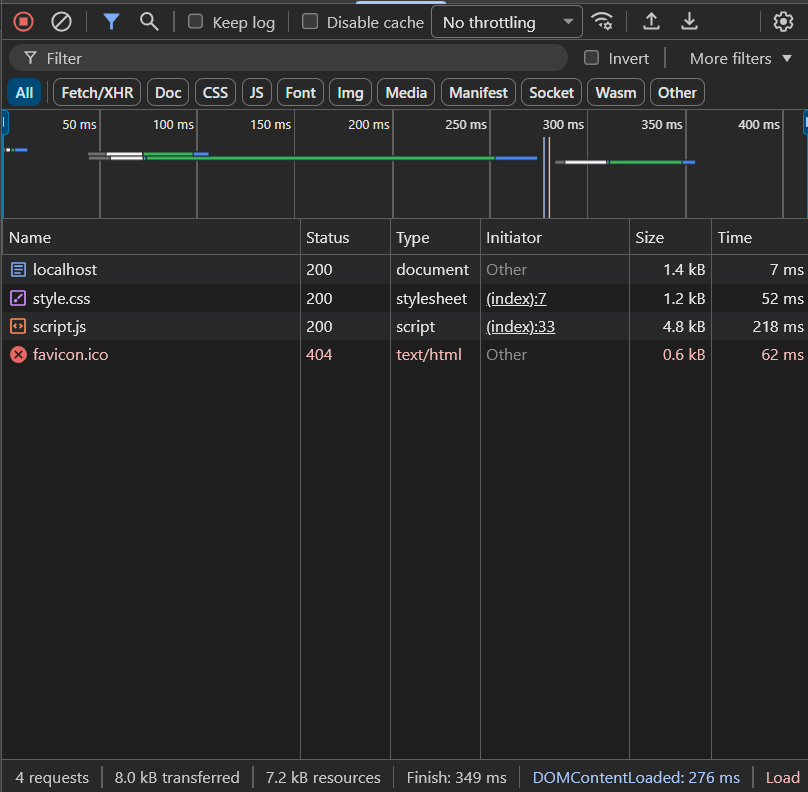

# Quiz Revisão Rápida

**Disciplina:** Desenvolvimento de Sistemas Web (EECP0036) - UFMA

**Aluno:** Anderson Carvalhal Pimenta (Matrícula: 20250013630)

**Trilha Escolhida:** Trilha C (Sem API externa)

**Acesso Online (Deploy no Render):** <https://quiz-wzuq.onrender.com>

## O que o app faz

O "Quiz Revisão Rápida" é uma aplicação web simples projetada para ajudar estudantes e concurseiros a testarem seus conhecimentos. Ele exibe perguntas de revisão, recebe e valida a resposta digitada pelo usuário, informa imediatamente se a resposta está correta ou incorreta, e mantém um registro da pontuação total utilizando o `localStorage` do navegador, sem necessidade de login ou banco de dados externo.

## Tecnologias Usadas

* **HTML5:** Estruturação semântica da página (`<header>`, `<main>`, `<section>`).
* **CSS3:** Estilização visual e responsividade (flexbox), construído do zero sem frameworks.
* **JavaScript:** Lógica do quiz e manipulação segura do DOM, injetando dados estritamente via `textContent` para evitar vulnerabilidades de XSS.
* **Web Storage API:** Utilização do `localStorage` para persistência dos dados de pontuação na máquina do cliente.

## Como rodar o projeto localmente

Para executar esta aplicação localmente e visualizar as requisições de rede originais:

1. Faça o clone deste repositório ou baixe os arquivos.
2. Abra a pasta do projeto no VS Code.
3. Utilize a extensão **Live Server** (clique em "Go Live") ou abra o terminal na pasta e rode o comando `python -m http.server 8000`.
4. Acesse `http://localhost:8000` no navegador.

## Análise da Aba Rede (Network)

A imagem acima exibe as requisições (método GET) realizadas pelo navegador durante o carregamento inicial da página rodando no servidor local (localhost).

Como optamos pela **Trilha C**, não há requisições para APIs externas. O status `200` confirma que o documento principal (`localhost`), a folha de estilos (`style.css`) e o script (`script.js`) foram entregues com sucesso. A requisição do arquivo `favicon.ico` retornou `404` apenas porque não declaramos um ícone de aba personalizado para a aplicação, o que é o comportamento padrão do navegador e não interfere no funcionamento do app.

## Uso de IA

* **Ferramenta utilizada:** Google Gemini.
* **O que foi pedido:** Ajuda para estruturar os textos da "Etapa 1: Proposta do App" com base nos requisitos da disciplina, e geração da base inicial do código (HTML semântico, CSS responsivo e lógica em JS com localStorage).
* **O que foi alterado:** O texto da proposta foi revisado e adaptado para o escopo do projeto. O código inicial gerado pela IA foi testado localmente, as variáveis e funções foram renomeadas para português para melhor clareza, os comentários foram reescritos e a lógica do botão de reiniciar foi ajustada. Foi feita uma revisão para garantir que o projeto atende à exigência de uso do `textContent` em vez do `innerHTML`.